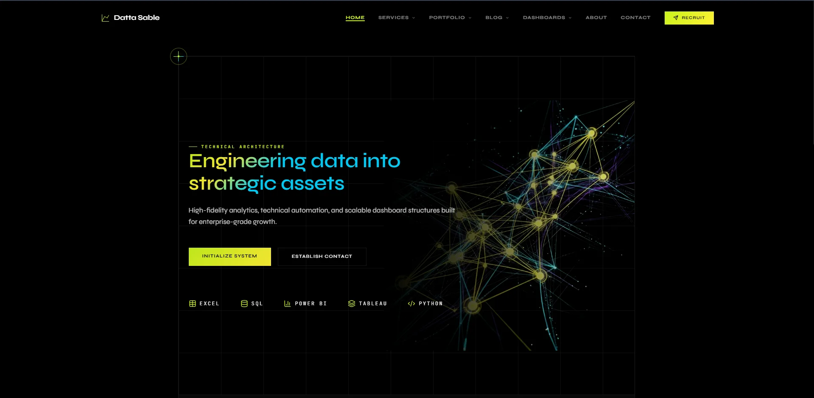
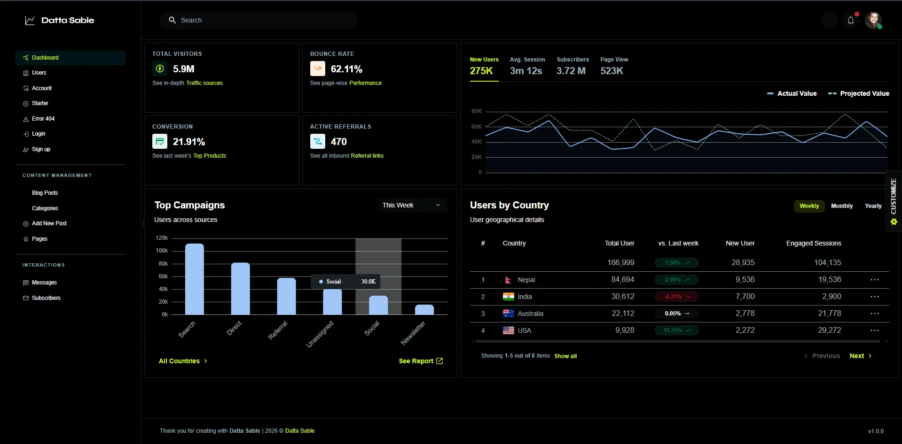
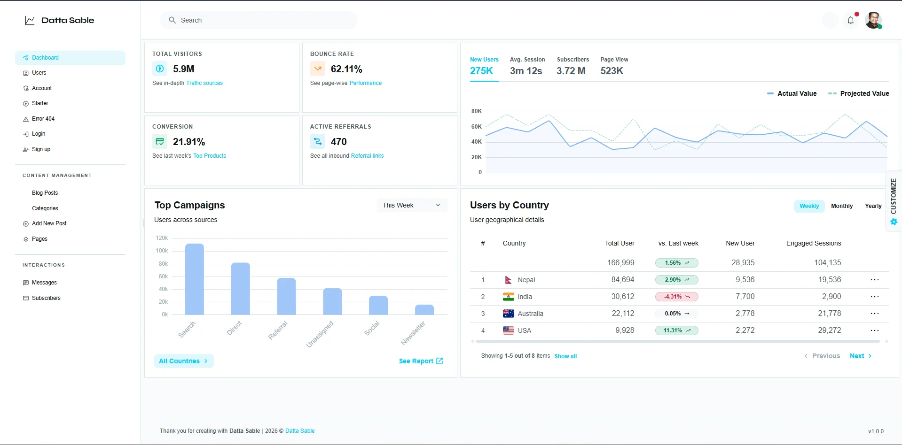
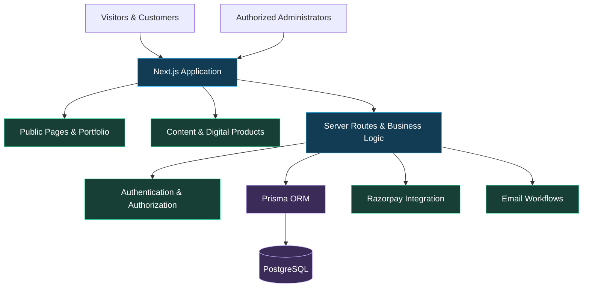

# DATTA SABLE
### Enterprise Intelligence · Analytics Engineering · Digital Innovation

<div align="center">

<h1>Transforming Data Into Decisions.<br/>Engineering Ideas Into Digital Products.</h1>

<p>
  <strong>Business Intelligence · Data Analytics · Automation · Digital Commerce</strong>
</p>

<p>
  A full-stack digital platform bringing together enterprise analytics,
  intelligent reporting, technical knowledge, professional services,
  and digital products.
</p>

[](https://dattasable.com)
[](https://dattasable.com/portfolio)
[](https://linkedin.com/in/dattasable)

<br/>


<br/>

[](https://github.com/sabledattatray/Datta-Sable/actions/workflows/ci.yml)
[](https://github.com/sabledattatray/Datta-Sable/stargazers)
[](https://github.com/sabledattatray/Datta-Sable/commits/main)
[](https://github.com/sabledattatray/Datta-Sable/issues)

</div>

---

## 01 / THE VISION

> **Build systems that turn complex information into measurable business value.**

**Datta Sable** is an integrated technology and analytics platform developed to demonstrate the intersection of business intelligence, data engineering, full-stack application development, and digital product innovation.

The platform combines a professional consulting presence with a production-oriented web application, content management capabilities, an analytics portfolio, customer account workflows, and digital commerce infrastructure.

Rather than presenting dashboards as isolated visualizations, the ecosystem focuses on the complete journey:

**Raw Data → Reliable Models → Actionable Insights → Better Decisions**

### What makes this platform different?

| Capability | Business Value |
|:---|:---|
| **Business Intelligence** | Transform operational data into decision-ready reporting |
| **Analytics Engineering** | Build reliable models, KPIs, and reporting workflows |
| **Automation** | Reduce repetitive reporting and manual processing |
| **Digital Products** | Distribute technical knowledge through structured resources |
| **Full-Stack Engineering** | Connect frontend experiences with secure backend services |
| **Technical Content** | Translate complex technologies into practical learning |
| **Enterprise UX** | Make sophisticated systems easier to understand and use |

---

## 02 / PLATFORM EXPERIENCE

<div align="center">

### A Digital Experience Built Around Clarity, Performance and Trust



<sub>Platform homepage · Responsive interface · Professional digital experience</sub>

</div>

<br/>

The interface emphasizes readable typography, purposeful layouts, responsive components, and a consistent visual language across public-facing and administrative experiences.

### Platform highlights

- Responsive, component-based application architecture
- Server-rendered and interactive web experiences
- Dynamic portfolio and project presentation
- Technical publishing and content management
- Customer authentication and protected resources
- Digital product catalog and payment workflows
- Administrative tools for managing platform operations
- Search-friendly page structure and metadata

---

## 03 / THE DIGITAL ECOSYSTEM

The platform supports multiple business and technology workflows through a connected application architecture.

| Domain | Core Capabilities | Explore |
|:---|:---|:---|
| **Professional Services** | BI consulting, reporting, automation, analytics solutions | [Services](https://dattasable.com/services) |
| **Portfolio** | Analytics projects, technical implementations, case studies | [Portfolio](https://dattasable.com/portfolio) |
| **Digital Products** | Premium learning resources, eBooks, technical materials | [Products](https://dattasable.com/products) |
| **Technical Publishing** | Articles, tutorials, engineering insights | [Blog](https://dattasable.com/blog) |
| **Interactive Dashboards** | Business reporting and data visualization demonstrations | [Dashboards](https://dattasable.com/dashboards) |
| **Microsoft Fabric** | Fabric architecture, analytics engineering and technical resources | [Fabric Hub](https://fabric.dattasable.com/) |
| **Excel Analytics** | Spreadsheet-driven dashboard generation | [Excel Platform](https://excel.dattasable.com/) |

> **Architecture note:** Linked companion applications may be maintained or deployed independently. They are presented as part of the wider professional ecosystem, not necessarily as modules of this repository.

---

## 04 / BUSINESS INTELLIGENCE & ANALYTICS

<div align="center">

### From Complex Datasets to Executive-Level Intelligence



</div>

<br/>

Business intelligence is a central focus of the Datta Sable ecosystem.

The analytics portfolio demonstrates practical approaches to transforming complex business information into reliable reporting models, intuitive dashboards, and decision-support systems.

### Analytics capabilities

| Area | Focus |
|:---|:---|
| Data Preparation | Cleaning, validation, transformation, reconciliation |
| Data Modeling | Fact and dimension modeling, relationships, star schemas |
| Business Metrics | Revenue, profitability, growth, operations, performance |
| Dashboard Engineering | Interactive reports, filters, drilldowns, KPI storytelling |
| SQL Analytics | Querying, aggregations, joins, reporting datasets |
| Reporting Automation | Excel, Power Query, repeatable reporting workflows |
| Performance Optimization | Efficient calculations, model design, query tuning |

### Enterprise Power BI Portfolio

A multi-page business analytics portfolio covering nine complementary reporting perspectives.

| Dashboard | Analytical Focus |
|:---|:---|
| 01 · Executive Overview | Enterprise KPIs and performance |
| 02 · Sales Performance | Revenue trends and sales growth |
| 03 · Product Analysis | Product contribution and profitability |
| 04 · Customer Insights | Customer segments and behavior |
| 05 · Regional Analysis | Geographic business performance |
| 06 · Order Details | Transaction and order operations |
| 07 · Profitability Analysis | Margins, costs and profit drivers |
| 08 · Return Analysis | Returns and operational impact |
| 09 · Forecast Analysis | Trends and planning scenarios |

**Explore the dedicated project:**

[Enterprise Power BI Dashboard Repository](https://github.com/sabledattatray/enterprise-power-bi-dashboard)

> Portfolio datasets and reported metrics may use synthetic demonstration data. Such figures should not be interpreted as actual business results.

---

## 05 / DIGITAL PRODUCTS & COMMERCE

### Technical Knowledge, Delivered as Digital Products

The platform extends beyond a traditional portfolio by supporting a digital product experience.

Its commerce architecture brings together product discovery, customer access, payment integration, and protected digital delivery.

### Product platform capabilities

| Component | Purpose |
|:---|:---|
| Product Catalog | Present digital learning products and resources |
| Product Detail Pages | Explain features, contents, and intended audience |
| Razorpay Integration | Support online payment workflows |
| Payment Verification | Validate payment events before fulfillment |
| Protected Delivery | Restrict access to purchased digital assets |
| Customer Accounts | Support authenticated access to resources |
| Administrative Management | Manage catalog and commerce operations |

### Learning and digital resources

The product strategy includes technical materials for:

- Microsoft Power BI
- Microsoft Fabric
- Data analytics and reporting
- Advanced Excel
- SQL and data modeling
- Business intelligence career development

**Explore:** [Digital Products](https://dattasable.com/products)

> Payment processing and digital delivery are security-sensitive workflows. Production credentials, internal fulfillment details, and customer information are intentionally excluded from public documentation.

---

## 06 / ADMIN COMMAND CENTER

<div align="center">

### Operational Control Through a Unified Workspace

<table>
<tr>
<td width="50%" align="center">

<br/>
<sub>Administration Interface</sub>
</td>
<td width="50%" align="center">

<br/>
<sub>Analytics Experience</sub>
</td>
</tr>
</table>

</div>

The administrative workspace provides a centralized environment for managing platform content and operational workflows.

### Management areas

**Content & Publishing**
- Blog and article administration
- Content organization
- Publishing workflows
- Portfolio presentation

**Products & Commerce**
- Digital product management
- Product metadata and assets
- Commerce administration
- Protected resource workflows

**Users & Access**
- Account authentication
- Access-controlled functionality
- Email verification
- Administrative authorization

**Platform Operations**
- Application configuration
- Content maintenance
- Operational workflows
- Technical administration

Administrative functionality is restricted to authorized users.

---

## 07 / ENGINEERING ARCHITECTURE

### Built With a Modern Full-Stack Technology Foundation

The repository uses Next.js, React, TypeScript, Prisma, and PostgreSQL to connect public experiences with server-side application logic.



<sub>Conceptual architecture. Simplified to communicate the major application layers; not an infrastructure or security boundary diagram.</sub>

### Technology stack

| Layer | Technologies |
|:---|:---|
| Application Framework | Next.js 15, React 19 |
| Programming Language | TypeScript 5 |
| Styling | Tailwind CSS 4, Sass |
| UI Components | Material UI, Radix UI, Lucide |
| Animation | Framer Motion |
| State Management | Zustand |
| Database | PostgreSQL |
| ORM | Prisma 5 |
| Authentication | NextAuth |
| Validation | Zod |
| Rich Text Editing | Tiptap |
| Data Visualization | Apache ECharts |
| Spreadsheet Processing | SheetJS, PapaParse |
| Payments | Razorpay |
| Email | Nodemailer |
| Image Processing | Sharp |
| Runtime | Node.js |

The technology list is based on repository dependencies. Individual libraries may serve different application features and do not necessarily run on every page.

---

## 08 / APPLICATION SECURITY

### Security Is a Core Engineering Responsibility

The application includes authentication, account management, and protected administrative functionality.

Security-related engineering areas include:

- Authentication and session management
- Authorization for restricted resources
- Email verification workflows
- Multi-factor authentication support
- Input validation and sanitization
- Payment verification
- Protected digital asset delivery
- Server-side configuration management
- Environment-based secrets

### Security principles

**Least Privilege**  
Grant access according to the responsibilities of the authenticated user.

**Server-Side Trust Boundaries**  
Enforce authorization and sensitive business logic on trusted server-side paths.

**Secret Protection**  
Keep credentials, payment secrets, database URLs, and private tokens outside source control.

**Payment Integrity**  
Verify payment status using trusted provider-side evidence before granting access to purchased resources.

**Defense in Depth**  
Use validation, authentication, authorization, monitoring, and secure configuration together.

> This section describes the application's security design goals and implemented feature areas. It does not constitute a third-party security certification or independent penetration-test result.

For responsible vulnerability disclosure, use the repository's private security reporting channel where available, or contact the project maintainer privately.

---

## 09 / TECHNICAL CONTENT & KNOWLEDGE SHARING

### Engineering Knowledge for Real-World Applications

The technical publishing platform covers practical topics across business intelligence, analytics engineering, Microsoft Fabric, and data-driven systems.

**Core subject areas**

- Power BI development and optimization
- DAX and semantic modeling
- Microsoft Fabric architecture
- Direct Lake and OneLake
- Data Factory and data integration
- SQL analytics and performance
- Excel automation
- Data engineering workflows
- Business reporting strategy

**Read technical articles:** [Datta Sable Blog](https://dattasable.com/blog)

**Explore Fabric resources:** [Microsoft Fabric Hub](https://fabric.dattasable.com/)

The goal is to make complex engineering concepts understandable through architecture explanations, implementation guidance, and practical examples.

---

## 10 / REPOSITORY STRUCTURE

```text
Datta-Sable/
│
├── .github/
│   └── workflows/       # GitHub automation and CI
│
├── app/                 # Next.js application routes
├── components/          # Reusable UI components
├── content/             # Content and publishing resources
├── data/                # Application data resources
├── docs/                # Technical documentation
├── lib/                 # Shared utilities and server logic
├── prisma/              # Database schema and migrations
├── public/              # Static assets and images
├── scripts/             # Maintenance and operational scripts
├── store/               # Application state
├── tests/               # Automated tests
│
├── middleware.ts        # Request middleware
├── next.config.ts       # Next.js configuration
├── package.json         # Dependencies and scripts
├── tsconfig.json        # TypeScript configuration
└── README.md            # Project documentation
```

The repository is organized around a modular Next.js application structure, with shared components, database models, tests, and operational utilities.

---

## 11 / LOCAL DEVELOPMENT

### Prerequisites

Before running the project locally, prepare:

- A compatible Node.js runtime
- npm
- PostgreSQL
- Required environment configuration
- Appropriate credentials for any enabled external integrations

### Clone and install

```bash
git clone https://github.com/sabledattatray/Datta-Sable.git

cd Datta-Sable

npm ci
```

### Configure the environment

Create a local `.env` file using the environment documentation and relevant example configuration files.

An eBook-specific example is available in:

```text
.env.ebooks.example
```

Not all application configuration is necessarily covered by this single example.

Never commit real database credentials, authentication secrets, email credentials, or payment provider keys.

### Generate Prisma Client

```bash
npx prisma generate
```

### Prepare the database

For a fresh development database with the required migrations:

```bash
npx prisma migrate deploy
```

This assumes the required migration files are available and the target database is correctly configured.

Do not run migration or seed commands against production data without reviewing their effects.

### Start the development server

```bash
npm run dev
```

Open:

```text
http://localhost:3000
```

### Available project commands

| Command | Purpose |
|:---|:---|
| `npm run dev` | Start development server |
| `npm run build` | Generate Prisma Client and build application |
| `npm run start` | Start production server |
| `npm run lint` | Run ESLint |
| `npm test` | Run automated Node.js tests |
| `npm run test:campaigns` | Run campaign-specific tests |

Some functionality requires additional environment configuration or access to external services.

---

## 12 / QUALITY ENGINEERING

### Quality Through Validation, Testing and Continuous Improvement

The repository includes automated tests and a GitHub Actions CI workflow.

[](https://github.com/sabledattatray/Datta-Sable/actions/workflows/ci.yml)

### Engineering priorities

| Quality Dimension | Engineering Objective |
|:---|:---|
| Reliability | Predictable application behavior |
| Maintainability | Modular, understandable source code |
| Performance | Efficient rendering and resource delivery |
| Accessibility | Usable interfaces across devices and abilities |
| Security | Appropriate access controls and validation |
| Data Integrity | Consistent, trustworthy application data |
| Responsiveness | Adaptable desktop and mobile layouts |
| SEO | Discoverable, structured public content |

### Local verification

```bash
# Run automated tests
npm test

# Run static lint checks
npm run lint

# Verify the production build
npm run build
```

Performance and accessibility should be evaluated using dated, reproducible measurements.

Scores may vary by route, device, network conditions, and deployment version.

---

## 13 / PROFESSIONAL EXPERTISE

### Business Intelligence Meets Engineering Execution

The platform reflects professional experience in management information systems, reporting, analytics, and business intelligence.

**Specialization areas**

| Discipline | Expertise |
|:---|:---|
| Business Intelligence | Power BI, dashboards, KPI development |
| MIS & Reporting | Management reporting, operational analytics |
| Advanced Excel | Power Query, PivotTables, reporting automation |
| SQL | Data extraction, transformations, reporting queries |
| Data Modeling | Star schemas, relationships, semantic models |
| Analytics Automation | Repeatable data processing and reporting |
| Microsoft Fabric | Analytics architecture and engineering |
| Web Engineering | Next.js, TypeScript, database-backed applications |

### Professional focus

Building practical solutions that help organizations:

- Improve visibility into business performance
- Reduce manual reporting effort
- Strengthen data consistency
- Understand operational trends
- Create scalable analytical workflows
- Communicate insights more effectively

---

## 14 / CONNECTED PROJECTS

### Explore the Wider Engineering Portfolio

| Project | Description |
|:---|:---|
| [Datta Sable](https://dattasable.com) | Main professional platform |
| [Enterprise Power BI Dashboard](https://github.com/sabledattatray/enterprise-power-bi-dashboard) | Multi-page enterprise BI portfolio |
| [Excel Dashboard Generator](https://excel.dattasable.com/) | Spreadsheet-to-dashboard experience |
| [Microsoft Fabric Hub](https://fabric.dattasable.com/) | Fabric engineering and technical resources |
| [ATSAI Talent Solutions](https://atsai.pro/) | Recruitment and applicant tracking platform |
| [BI Expert](https://biexpert.online/) | Business intelligence-focused web presence |

These are associated professional projects and platforms. Their repositories, hosting arrangements, and operational environments may differ.

---

## 15 / PROJECT STATUS & DEVELOPMENT

### Actively Developed

The Datta Sable ecosystem continues to evolve through improvements to application architecture, user experience, analytics presentation, digital product delivery, and administrative workflows.

Development priorities include:

- Improving the public portfolio experience
- Expanding high-quality technical content
- Refining digital commerce workflows
- Strengthening application security
- Improving accessibility and responsiveness
- Maintaining automated tests
- Documenting system architecture
- Enhancing discoverability and user experience

For the latest development history, see:

[Commit History](https://github.com/sabledattatray/Datta-Sable/commits/main) ·
[GitHub Actions](https://github.com/sabledattatray/Datta-Sable/actions) ·
[Releases](https://github.com/sabledattatray/Datta-Sable/releases)

---

## 16 / COLLABORATION & USAGE

This repository is publicly visible for technical demonstration and portfolio purposes.

Public visibility does not automatically grant permission to reuse, redistribute, or commercially deploy the source code.

Please review the repository's applicable license and permissions before using its contents beyond GitHub's permitted viewing and forking functionality.

For collaboration, integration discussions, or professional inquiries, contact the maintainer.

---

## 17 / LET'S BUILD SOMETHING VALUABLE

<div align="center">

<h2>Have Data. Need Clarity. Want Better Decisions?</h2>

<p>
  Available for discussions involving business intelligence,
  reporting automation, analytics engineering,
  and data-driven digital solutions.
</p>

[](https://dattasable.com)
[](https://dattasable.com/portfolio)
[](https://linkedin.com/in/dattasable)

<br/>

**Datta Sable**  
Business Intelligence · Data Analytics · Full-Stack Digital Solutions

**Website:** https://dattasable.com  
**LinkedIn:** https://linkedin.com/in/dattasable  
**Email:** contact@dattasable.com

<br/>

---

### ENGINEERED FOR INSIGHT. DESIGNED FOR IMPACT.

<sub>© 2026 Datta Sable. All rights reserved.</sub>

<br/>

<sub>Built with Next.js · React · TypeScript · PostgreSQL · Prisma</sub>

<br/>

**If this project is useful, consider giving the repository a star.**

[](https://github.com/sabledattatray/Datta-Sable)

</div>
