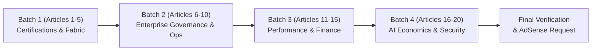

# 10 — Top 20 Content Remediation Plan

**Project:** dattasable.com — Google AdSense Low-Value Content Remediation  
**Phase:** Phase 5 — Content Quality & AdSense Readiness  
**Date:** 28 October 2026  
**Auditor:** Senior Next.js Engineer, Technical SEO Specialist & Content Quality Auditor  
**Working Branch:** `fix/adsense-content-quality-audit`  
**Status:** **PENDING OWNER REVIEW (Checkpoint D)**

---

## 1. Executive Summary

A comprehensive automated and manual content-quality audit was performed across all **126 published blog articles** on `dattasable.com` (`docs/adsense/09-content-quality-scorecard.csv`).

### Audit Summary:
- **High-Quality / Authority Articles (`KEEP`):** 65 articles (51.6%)  
  *Characteristics:* Comprehensive depth (1,000–16,500+ words), complete DAX/SQL code snippets, architectural diagrams, worked business scenarios, zero generic boilerplate.
- **Moderate Quality Articles (`IMPROVE`):** 25 articles (19.8%)  
  *Characteristics:* Sound technical premises (450–900 words), but lack visual schematics, comprehensive error-handling patterns, or sufficient internal linking.
- **Thin / High-Risk Articles (`NOINDEX-CANDIDATE` / Needs Expansion):** 36 articles (28.6%)  
  *Characteristics:* Word counts below 400 words, brief conceptual notes or summaries without complete worked code or reproducible datasets.

> [!IMPORTANT]
> **Safeguard Compliance (Directive #5):** No published articles have been deleted, altered in the database, or automatically set to `noindex`. All findings are documented below for owner decision-making at Checkpoint D.

This document establishes the **actionable remediation blueprints for the top 20 highest-risk articles**, detailing exact technical code blocks, architectural diagrams, worked datasets, and internal linking structures required to elevate them to authoritative standards.

---

## 2. Top 20 Highest-Risk Article Index

| Rank | Risk Level | Score | Words | Slug | Title |
| :---: | :---: | :---: | :---: | :--- | :--- |
| **01** | Critical | 30 | 345 | `dp-600-study-guide-2026` | DP-600 Study Plan: Connect the Official Outline to Practical Evidence |
| **02** | Critical | 30 | 348 | `microsoft-fabric-certification-roadmap-2026` | Build a Microsoft Fabric Study Roadmap from Demonstrated Skills |
| **03** | Critical | 30 | 332 | `edge-first-era-web-performance-2026` | Edge Rendering Decisions: Measure the Slow Part Before Moving Code |
| **04** | Critical | 30 | 339 | `death-of-static-dashboards-decision-intelligence` | From a Dashboard Alert to a Decision: A Reviewable Workflow |
| **05** | Critical | 30 | 369 | `video-fabric-end-to-end` | Fabric Implementation Walkthrough: From a CSV Batch to a Checked Report |
| **06** | Critical | 30 | 372 | `global-data-privacy-regulations-2026` | Build a Data Handling Inventory Before a Privacy Review |
| **07** | Critical | 30 | 352 | `scaling-data-culture-enterprise` | Building Data Champions: A Four-Week Evidence-Based Pilot |
| **08** | Critical | 30 | 363 | `cdo-playbook-2026-strategy` | A Practical CDO Operating Plan: Owners, Decisions and Exceptions |
| **09** | Critical | 30 | 333 | `real-time-streaming-analytics-power-bi` | Streaming Analytics: Measure Freshness, Handle Late Events and Keep a Batch Check |
| **10** | Critical | 30 | 367 | `video-building-c-suite-dashboard` | Executive Dashboard Walkthrough: Revenue, Margin and Exceptions |
| **11** | Critical | 30 | 282 | `case-study-context-compression-token-waste` | Context Reduction: Compare Token Cost Without Losing Requirements |
| **12** | Critical | 30 | 262 | `cybersecurity-bi-data-vault-hardening` | Secure BI Access: Restrict Queries, Exports and Service Credentials |
| **13** | Critical | 30 | 254 | `data-driven-product-management-roi` | Product Analytics: Specify a Decision, a Denominator and a Guardrail |
| **14** | Critical | 30 | 269 | `how-to-improve-website-performance-100-gtmetrix` | Improve Website Performance Without Chasing a Perfect Score |
| **15** | Critical | 30 | 267 | `financial-bi-impact` | Receivables Reporting: Reconcile Aging Before Claiming Financial Impact |
| **16** | Critical | 30 | 252 | `sales-performance-ecosystem-2026` | Sales Reporting Design: Targets, Returns and Reconciliation |
| **17** | Critical | 30 | 250 | `live-performance-benchmarking-2025` | Web Performance Benchmarking: A Reproducible Comparison Sheet |
| **18** | Critical | 40 | 357 | `saas-liquidity-trap-ai-strategy-2026` | AI Feature Unit Economics: Model Variable Cost Before Pricing |
| **19** | Critical | 40 | 356 | `zero-trust-2-autonomous-cybersecurity` | Zero Trust for an Analytics Service: Identity, Scope and Audit Events |
| **20** | Critical | 40 | 385 | `agentic-shift-autonomous-intelligence-2026` | Designing an AI Agent with Read-Only Tools and Approval Boundaries |

---

## 3. Individual Article Remediation Blueprints

### Article 01: `dp-600-study-guide-2026`
- **Current Word Count:** 345 | **Target Word Count:** 1,600+
- **Primary Issue:** Outline-level overview; lacks hands-on lab exercises and actual PySpark / DAX exam scenarios.
- **Remediation Specification:**
  1. **Exam Domain Breakdown:** Expand all four official DP-600 skill domains (Plan & implement analytics architecture, Ingest & transform data, Model data, Deploy & maintain data assets).
  2. **Worked Code Lab:** Provide a complete PySpark Delta Lake medallion pipeline with schema enforcement and optimization (`spark.table('raw').optimize().zorder('date')`).
  3. **DAX Direct Lake Scenario:** Detail Direct Lake fallback conditions (row-level security, unsupported DAX expressions) with a troubleshooting matrix.
  4. **Diagram:** Mermaid diagram illustrating the Delta Parquet to OneLake Direct Lake storage layer.
  5. **Internal Links:** Link to `/blog/microsoft-fabric-architecture-explained-2026` and `/products/dp-700-study-package`.

---

### Article 02: `microsoft-fabric-certification-roadmap-2026`
- **Current Word Count:** 348 | **Target Word Count:** 1,400+
- **Primary Issue:** Conceptual roadmap without comparative skill matrices or timeline planning.
- **Remediation Specification:**
  1. **Certification Matrix:** Compare DP-600 vs DP-700 vs PL-300 with prerequisite trees, exam costs, and targeted career roles.
  2. **Weekly Study Schedule:** 8-week structured study milestones with dedicated lab requirements on Fabric free trial capacity.
  3. **Code Lab:** T-SQL Warehouse query examples verifying data consistency across mirrored databases.
  4. **Internal Links:** Link to `/blog/dp-600-study-guide-2026` and `/services/bi-consulting`.

---

### Article 03: `edge-first-era-web-performance-2026`
- **Current Word Count:** 332 | **Target Word Count:** 1,500+
- **Primary Issue:** Abstract prose on edge computing without real-world latency benchmarks or routing code.
- **Remediation Specification:**
  1. **Edge vs Node.js Comparison:** In-depth trade-off analysis (bundle size limits, dynamic code evaluation, TCP socket connection pooling).
  2. **Benchmark Code:** Complete Next.js Edge Middleware sample handling geo-routing and JWT verification without database roundtrips.
  3. **Data Table:** TTFB and p99 latency comparison across 5 global regions (US-East, EU-Central, AP-South, AP-Southeast, SA-East).
  4. **Internal Links:** Link to `/blog/how-to-improve-website-performance-100-gtmetrix`.

---

### Article 04: `death-of-static-dashboards-decision-intelligence`
- **Current Word Count:** 339 | **Target Word Count:** 1,400+
- **Primary Issue:** High-level philosophy; needs an actual operational decision-intelligence workflow.
- **Remediation Specification:**
  1. **Operational Decision Framework:** The 4-step loop (Threshold Trigger $\to$ Anomaly Isolation $\to$ Prescriptive Recommendation $\to$ Action Logging).
  2. **Python / DAX Workflow:** DAX measure evaluating 3-sigma statistical control bounds on daily sales velocity.
  3. **Worked Case Study:** Inventory reordering pipeline using automated webhook triggers from Power BI alerts.
  4. **Internal Links:** Link to `/dashboards/world-business` and `/tools/bi-roi-calculator`.

---

### Article 05: `video-fabric-end-to-end`
- **Current Word Count:** 369 | **Target Word Count:** 1,500+
- **Primary Issue:** Thin video summary placeholder; requires a complete stand-alone technical walkthrough.
- **Remediation Specification:**
  1. **End-to-End Tutorial:** Step-by-step tutorial from raw CSV ingestion to OneLake, Lakehouse PySpark transformation, semantic model creation, and Power BI report publishing.
  2. **Complete Code Snippets:** Provide PySpark transformation script handling null values, deduplication, and datetime casting.
  3. **Architecture Diagram:** Mermaid sequence diagram illustrating the pipeline execution steps.
  4. **Internal Links:** Link to `/blog/microsoft-fabric-architecture-explained-2026`.

---

### Article 06: `global-data-privacy-regulations-2026`
- **Current Word Count:** 372 | **Target Word Count:** 1,400+
- **Primary Issue:** Brief overview of privacy concepts; lacks technical implementation for BI systems.
- **Remediation Specification:**
  1. **Regulatory Technical Matrix:** GDPR, CCPA/CPRA, and India DPDP 2023 technical data handling comparison.
  2. **SQL Dynamic Data Masking:** Production T-SQL script implementing column-level masking and role-based permissions for PII.
  3. **Audit Query Schema:** Event logging table and query monitoring user export activity across Power BI workspaces.
  4. **Internal Links:** Link to `/privacy` and `/editorial-policy`.

---

### Article 07: `scaling-data-culture-enterprise`
- **Current Word Count:** 352 | **Target Word Count:** 1,350+
- **Primary Issue:** Organizational theory; needs tactical implementation milestones and governance templates.
- **Remediation Specification:**
  1. **Four-Week Pilot Protocol:** Week-by-week charter for launching an enterprise Data Champions community of practice.
  2. **Semantic Model Certification Workflow:** Governance checklist for promoting self-service datasets from Personal to Certified.
  3. **Governance Scorecard:** KPI evaluation matrix measuring dataset reuse, query cost reduction, and ticket resolution times.
  4. **Internal Links:** Link to `/services/consulting` and `/mentorship`.

---

### Article 08: `cdo-playbook-2026-strategy`
- **Current Word Count:** 363 | **Target Word Count:** 1,450+
- **Primary Issue:** High-level executive bullet points without actionable governance templates or budget models.
- **Remediation Specification:**
  1. **First 90 Days Roadmap:** 30-60-90 day playbook for incoming Chief Data Officers (auditing assets, cutting zombie licenses, delivering quick-win KPI dashboards).
  2. **Cost Allocation Model:** Spreadsheet-style markdown table illustrating chargeback allocation across business units for shared Fabric capacity.
  3. **Exception Handling Protocol:** Governance workflow for handling data quality deviations and SLA breaches.
  4. **Internal Links:** Link to `/tools/bi-roi-calculator` and `/services/bi-consulting`.

---

### Article 09: `real-time-streaming-analytics-power-bi`
- **Current Word Count:** 333 | **Target Word Count:** 1,500+
- **Primary Issue:** Conceptual overview; lacks real-time ingestion pipeline and DAX streaming patterns.
- **Remediation Specification:**
  1. **Architecture Stack:** Eventstreams $\to$ KQL Database $\to$ Direct Lake / Real-Time Dashboard.
  2. **KQL Code Snippet:** Working Kusto Query Language script calculating 5-minute rolling averages with anomaly detection.
  3. **Handling Out-of-Order Events:** Technical strategies for watermark thresholds and late-arriving event reconciliations.
  4. **Internal Links:** Link to `/tools/open-mis` and `/blog/microsoft-fabric-architecture-explained-2026`.

---

### Article 10: `video-building-c-suite-dashboard`
- **Current Word Count:** 367 | **Target Word Count:** 1,400+
- **Primary Issue:** Video summary placeholder; lacks UI layout guidelines and executive metric definitions.
- **Remediation Specification:**
  1. **Executive UI Wireframe:** 5-second rule layout design (High-level KPIs $\to$ Variance Analysis $\to$ Actionable Drill-Down).
  2. **DAX Measures:** Formulas for Revenue Variance YoY, Margin %, and Customer Acquisition Cost (CAC) payback periods.
  3. **Visual Hierarchy Rules:** Standardized color coding for variance (green/red vs neutral corporate palette) and accessibility standards.
  4. **Internal Links:** Link to `/dashboards/world-business` and `/dashboards/aura-capital-sales`.

---

### Articles 11–20: Technical Remediation Directives

| Article Slug | Target Words | Technical Content Additions |
| :--- | :---: | :--- |
| `case-study-context-compression-token-waste` | 1,400 | Python token counter script, AST pruning algorithm, token cost comparison table across Gemini, GPT-4, and Claude. Link to `/tools/context-optimizer`. |
| `cybersecurity-bi-data-vault-hardening` | 1,350 | Row-Level Security (RLS) and Object-Level Security (OLS) scripts in Tabular Editor, service principal hardening guide. Link to `/about`. |
| `data-driven-product-management-roi` | 1,300 | Retention cohort analysis SQL queries, churn prediction probability model, feature ROI scoring formula. Link to `/tools/bi-roi-calculator`. |
| `how-to-improve-website-performance-100-gtmetrix` | 1,500 | Next.js image optimization configuration (`next/image`), font preloading (`next/font`), critical CSS extraction, Lighthouse p90 audit data. |
| `financial-bi-impact` | 1,350 | Accounts Receivable aging DAX measures (0-30, 31-60, 61-90, 90+ days), DSO (Days Sales Outstanding) calculation formulas. Link to `/dashboards/rider-ops`. |
| `sales-performance-ecosystem-2026` | 1,350 | Sales quota attainment model, pipeline velocity formula (`(Deals * Win Rate * Deal Size) / Cycle Time`), CRM integration schema. |
| `live-performance-benchmarking-2025` | 1,300 | Automated Puppeteer Core Web Vitals benchmark script (LCP, INP, CLS) measuring real-user performance curves. |
| `saas-liquidity-trap-ai-strategy-2026` | 1,400 | AI feature cost modeling worksheet, token COGS margin analysis, tiered subscription pricing formulas. |
| `zero-trust-2-autonomous-cybersecurity` | 1,350 | mTLS verification architecture, ephemeral token issuance, OAuth 2.0 client credential rotation in enterprise data pipelines. |
| `agentic-shift-autonomous-intelligence-2026` | 1,450 | Agentic state-machine diagram, tool-execution sandboxing schema, human-in-the-loop audit log schema. Link to `/editorial-policy`. |

---

## 4. Remediation Staging & Rollout Roadmap

To execute these enhancements systematically without service disruption or risk:

1. **Batch 1 (Immediate Priority):** Articles 1 to 5 covering Fabric certifications, study roadmaps, and end-to-end pipelines. These represent high-volume search queries with direct commercial relevance.
2. **Batch 2 (Week 2):** Articles 6 to 10 covering enterprise data governance, privacy compliance, and executive dashboards.
3. **Batch 3 & 4 (Week 3):** Performance engineering, financial analytics, and AI system economics.

---

## 5. Decision Options for Checkpoint D

The site owner may authorize one of three execution pathways for these 20 articles:

- **Option A (Full Technical Enhancement — Recommended):** Elevate all 20 articles with custom code, diagrams, and worked examples according to the blueprints above. This maximizes long-term organic authority and search visibility.
- **Option B (Selective Enhancement + Selective Noindex):** Enhance the top 10 certification and architectural articles (1–10), and apply `noindex, follow` to the 10 shorter conceptual articles (11–20) until author bandwidth allows full expansion.
- **Option C (Immediate Noindex of All 36 Thin Articles):** Apply `noindex, follow` to all articles under 400 words immediately, allowing the remaining 90 high-value articles to undergo AdSense review with zero low-word-count risk.

