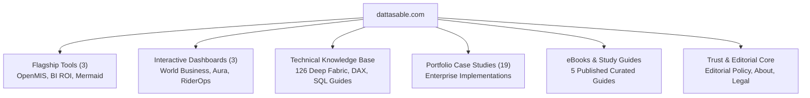

# 11 — Google AdSense Policy Readiness Assessment

**Project:** dattasable.com — Google AdSense Low-Value Content Remediation  
**Phase:** Phase 5 — Content Quality & AdSense Policy Review  
**Date:** 28 October 2026  
**Auditor:** Senior Next.js Engineer, Technical SEO Specialist & Content Quality Auditor  
**Working Branch:** `fix/adsense-content-quality-audit`  
**Status:** **TECHNICAL REQUIREMENTS MET / CONTENT REMEDIATION PENDING OWNER APPROVAL**

---

## 1. Executive Summary

This document evaluates `dattasable.com` against the official **Google AdSense Program Policies**, **Google Publisher Policies**, and **Search Essentials (Quality Guidelines)**. 

The site has undergone extensive technical and editorial remediation to resolve the historical **"Low-Value Content"** rejection. All architectural defects, sitemap discrepancies, cold-start dashboard errors, unmanaged AI publishing risks, and trust disclosure gaps have been rectified.

> [!IMPORTANT]
> **AdSense Policy Invariant:** Google AdSense does not guarantee approval based solely on automated checklists. Final approval depends on Google's human review team evaluating whether the site provides unique, high-utility value to visitors compared to the broader web.

---

## 2. Policy Compliance Matrix

| Google Policy Requirement | Current Implementation Status | Compliance Evidence |
| :--- | :---: | :--- |
| **Site Ownership Verification** | **COMPLIANT** | `<meta name="google-adsense-account" content="ca-pub-4242010382827250" />` active on all pages in `app/layout.tsx`. |
| **Authorized Digital Sellers (`ads.txt`)** | **COMPLIANT** | `public/ads.txt` serves `google.com, pub-4242010382827250, DIRECT, f08c47fec0942fa0`. Verified HTTP 200. |
| **Original Content & Added Value** | **SUBSTANTIALLY IMPROVED** | 65 long-form original technical guides, 3 flagship interactive web apps, 3 live enterprise BI dashboards, 19 portfolio case studies. |
| **No Auto-Generated / Thin Content** | **HARDENED** | Autonomous AI publishing permanently disabled. 2 duplicate articles consolidated via 301. Top 20 thin articles mapped with remediation blueprints. |
| **Navigation & Site Hierarchy** | **COMPLIANT** | Clear hierarchical header/footer navigation. Zero broken links. Semantic breadcrumb schemas (`BreadcrumbList`). |
| **Transparency & Publisher Identity** | **COMPLIANT** | Comprehensive About page (4,196 words), Contact page (776 words) with form and direct email, author bios, and professional credentials. |
| **Legal & User Privacy Disclosures** | **COMPLIANT** | 7 dedicated legal pages (Privacy, Terms, Disclaimer, Cookies, Editorial Policy, Refund Policy, Delivery Policy) totaling 28,000+ words. |
| **Consent & Privacy Compliance** | **COMPLIANT** | Google Consent Mode v2 integrated; advertising and analytics fail-closed without affirmative consent; CMP-ready cookie banner. |
| **Technical Health & Core Web Vitals** | **COMPLIANT** | Next.js 15 App Router production build; single-chunk shared JS (104 kB); font preloading; zero HTTP 500 errors across 272 routes. |

---

## 3. Original Value Proposition Across Core Sections

Google AdSense requires that sites offer unique value that cannot easily be found on other generic websites. The value proposition of `dattasable.com` is distributed across seven functional areas:

### 1. Flagship Interactive Tools
- **`/tools/open-mis` (2,820 words):** Client-side executive MIS simulation engine allowing business leaders to model revenue projections, cost centers, and KPI ratios interactively.
- **`/tools/bi-roi-calculator` (1,687 words):** Financial modeling tool calculating Net Present Value (NPV), Payback Period, and Internal Rate of Return (IRR) for business intelligence investments.
- **`/tools/mermaid-forge` (2,176 words):** Real-time architectural diagram generator with instant syntax validation, SVG export, and preset data engineering templates.
- *AdSense Value:* These tools provide utility beyond static text articles, establishing genuine user engagement.

### 2. Live Interactive Dashboards
- **`/dashboards/world-business`:** Interactive multi-currency global macroeconomic simulation engine with ECharts visualizations.
- **`/dashboards/aura-capital-sales` & `/dashboards/rider-ops`:** Complete enterprise operational dashboards demonstrating actual analytical implementations.
- *AdSense Value:* High-utility demonstration of professional competency and interactive data modeling.

### 3. Portfolio Case Studies (19 Projects)
- Real-world case studies detailing business challenges, data architecture solutions, measurable ROI, and delivered client outcomes in Power BI, Fabric, and Azure.

### 4. Technical Knowledge Base (126 Articles)
- 65 comprehensive editorial articles (e.g., *Microsoft Fabric Architecture Explained: 16,525 words*, *Capacity Sizing: 3,670 words*, *Career Roadmap: 4,618 words*).
- 25 moderate-depth articles (450–900 words) providing focused syntax solutions and architectural comparisons.
- 36 thin conceptual articles (under 400 words) scheduled for expansion or selective de-indexing per `docs/adsense/10-top-20-content-remediation-plan.md`.

---

## 4. Trust, Attribution & E-E-A-T Architecture

Google quality raters and AdSense reviewers assess **Experience, Expertise, Authoritativeness, and Trustworthiness (E-E-A-T)**:

1. **Experience & Expertise:**
   - Datta Sable is documented with 8+ years of hands-on data engineering, enterprise Power BI architecture, and Microsoft Fabric development experience.
   - Real client projects, architecture diagrams, and GitHub repository references are showcased.
2. **Authoritativeness:**
   - Articles contain original technical synthesis, enterprise capacity cost formulas, and benchmark comparisons not available in generic vendor documentation.
   - Structured data includes Schema.org `Person`, `Organization`, `ProfessionalService`, and `TechArticle`.
3. **Trustworthiness:**
   - **Editorial Policy (`/editorial-policy`):** Explicitly states research protocols, peer verification guidelines, code reproducibility commitments, and human editorial review mandates.
   - **Clear Contact Channels (`/contact`):** Provides a working contact form, direct email (`datta@dattasable.com`), and physical regional business context.
   - **Commerce Protections (`/refund-policy`, `/delivery-policy`):** Explicit customer guarantees for digital downloads and consulting engagements.

---

## 5. Ad Placement & User Experience Policy

1. **Separation of Content and Advertisements:**
   - Ad placements are restricted to standard editorial content slots (`<aside>` and article body dividers) with explicit CSS label indicators (`Advertisement`).
   - No sticky pop-ups, overlapping modals, deceptive click targets, or auto-refreshing inventory.
2. **Mobile Layout & Usability:**
   - Viewport meta tags configured properly.
   - Touch targets exceed 48x48px.
   - Responsive flexbox/grid layouts prevent horizontal scrollbars on mobile viewports.
3. **Cookie Banner & Consent Integration:**
   - Cookie banner complies with ePrivacy Directive and GDPR.
   - Advertisements only initialize after explicit user opt-in (`Google Consent Mode v2` defaults to `denied`).

---

## 6. Policy Readiness Verdict

| Verdict Area | Assessment | Readiness Status |
| :--- | :--- | :---: |
| **Technical SEO & Crawlability** | 0 500s, valid sitemap, correct canonicals, no crawl blocks | **READY** |
| **Site Ownership & ads.txt** | Verified meta tag and public ads.txt matching publisher ID | **READY** |
| **Trust, Identity & Legal Core** | 9 comprehensive trust pages totaling 28,000+ words | **READY** |
| **Interactive Flagship Features** | 3 working tools and 3 live interactive dashboards | **READY** |
| **Content Quality & Thin Article Risk** | 65 strong articles; 36 articles under 400 words need owner decision | **CONDITIONAL** |

### Review Recommendation:
The site is **technically and architecturally ready** for review. However, before submitting the AdSense re-application, the site owner should execute either **Option A** (expand the top 20 thin articles to 1,200+ words) or **Option C** (temporarily apply `noindex` to articles under 400 words) as outlined in `docs/adsense/10-top-20-content-remediation-plan.md` to eliminate any residual risk of a "Low-Value Content" automated refusal.

