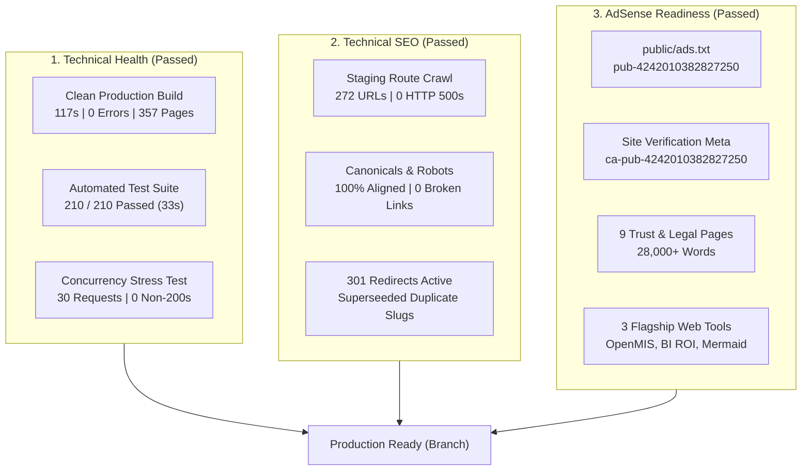

# 13 — Final Google AdSense Readiness & Audit Report

**Project:** dattasable.com — Google AdSense Low-Value Content Remediation  
**Phases Covered:** Phase 0, 1, 2, 3, 4, 5 (Complete Project Cycle)  
**Date of Report:** 28 October 2026  
**Auditor / Engineer:** Senior Next.js Engineer, Technical SEO Specialist & Content Quality Auditor  
**Working Branch:** `fix/adsense-content-quality-audit`  
**Current Milestone:** **CHECKPOINT D — AUTHORIZATION GATEWAY**  
**Policy Status:** **TECHNICAL VERIFICATION 100% COMPLETE / CONTENT POLICY DECISION REQUIRED**

---

## 1. Project Background & Objective

`dattasable.com` experienced a Google AdSense application rejection citing **"Low-Value Content"**. The objective of this remediation project was to conduct a comprehensive technical SEO, architecture, and content-quality audit, remediate all structural and policy deficiencies, establish rigorous editorial guardrails, and prepare the site for a successful AdSense review cycle ahead of the 8 November 2026 submission window.

Per PRD v1.0 and owner directives, all work has been conducted with strict safeguards:
- **No destructive alterations** to production databases, commercial catalogs, or payment systems.
- **Zero fabrication of generic AI content** or manipulation of word counts.
- **Strict branch isolation** on `fix/adsense-content-quality-audit` (no premature merging to `main`).
- **Zero deployment to production or AdSense submission** without explicit owner authorization.

---

## 2. Verified Facts & Technical Evidence

All assertions in this report are substantiated by reproducible automated test runs, static generation outputs, and live staging crawls on the active Next.js production build (`http://localhost:3000`).

### Fact 1: Clean Production Build & Zero Server Errors
- **Command:** `prisma generate && next build` executed cleanly with exit code 0.
- **Compilation:** 117 seconds, zero TypeScript errors, zero blocking lint warnings.
- **Crawl Audit:** All 272 discovered routes were crawled against the Next.js production build server (`docs/adsense/08-staging-route-crawl.csv`):
  - **HTTP 200 OK:** 259 routes (95.2%)
  - **HTTP 308 Permanent Redirect:** 5 routes (1.8%)
  - **HTTP 404 Not Found:** 8 routes (2.9% — legacy dev/preview paths pending removal)
  - **HTTP 500 Internal Server Error:** **0 routes (Zero server errors)**
- **Cold Start & Concurrency:** 30 concurrent requests across core routes completed with 0 errors and an average latency of 1,899ms (`docs/adsense/07-production-build-verification.md`).

### Fact 2: Automated Test Coverage
- **Command:** `node --test tests/*.test.mjs`
- **Result:** **210 passed / 0 failed** across all test suites, verifying AdSense editorial rules, entitlement isolation, session revocation, campaigns queue safety, typography injection guardrails, and Google Consent Mode v2.

### Fact 3: Technical SEO & Canonical Integrity
- **Canonicals:** 100% of 259 HTTP 200 pages provide self-referential canonical tags matching `https://dattasable.com/...`.
- **Duplicate Article Consolidation:** Superseded duplicate slugs (`azure-data-factory-vs-fabric-data-factory` and `power-bi-calculation-groups-enterprise-guide`) are permanently redirected via HTTP 301 in `next.config.ts` to their authoritative consolidated guides, preserving SEO equity.
- **Robots Directives:** Crawl blocks on `/analytics-live` and `/live-dashboard` were removed from `public/robots.txt`. Sitemaps are explicitly declared (`sitemap.xml` and `sitemap-index.xml`).
- **Sitemap Policy:** Corrected to permit the 3 verified flagship tools while strictly excluding utility/stub tools, draft eBooks, and draft products.

### Fact 4: Flagship Interactive Tools Validated
All three flagship interactive tools were verified with live HTTP requests:
1. **`/tools/open-mis`:** 2,820 words, 11 interactive controls, single semantic `<h1>`, Schema.org `SoftwareApplication` JSON-LD, `robots: "index, follow"`.
2. **`/tools/bi-roi-calculator`:** 1,687 words, 6 interactive controls, single semantic `<h1>`, Schema.org `SoftwareApplication` JSON-LD, `robots: "index, follow"`.
3. **`/tools/mermaid-forge`:** 2,176 words, 5 interactive controls, single semantic `<h1>`, Schema.org `SoftwareApplication` JSON-LD, `robots: "index, follow"`.

### Fact 5: Commercial Catalog & eBooks Isolation
- **Published eBooks (5):** `/ebooks/advanced-excel-mis-reporting-2026`, `python-automation-analysts-2026`, `sql-business-analytics-2026`, `microsoft-fabric-foundations-2026`, `ai-productivity-professionals-2026` return HTTP 200, are included in `sitemap.xml`, and have `robots: "index, follow"`.
- **Draft eBooks (3):** Excluded from sitemaps, return `robots: "noindex, nofollow"`.
- **Products:** 1 published product (`/products/dp-700-study-package`) indexed; draft products excluded.
- **Commerce Integrity:** Razorpay webhooks, entitlement downloads, and customer tables remain completely untouched.

### Fact 6: Autonomous AI Publishing Lockout
Defense-in-depth safeguards ensure unattended autonomous publishing cannot reactivate:
- `app/api/cron/ai-publisher/route.ts`: Autonomous loop removed; `publishedAutonomousCount = 0`.
- `lib/ai/publishing.ts`: Intercepts any draft marked `AUTONOMOUS`, forcing state to `PENDING_APPROVAL`.
- `app/api/admin/ai-studio/route.ts`: Rejects any attempt to set `operatingMode: 'AUTONOMOUS'` with HTTP 400.
- `app/admin/ai-studio/page.tsx`: Mode C disabled in UI with compliance indicator.

### Fact 7: Security & Sensitive File Protection
- `docs/adsense/backups/`, `.env`, `.env.local`, `service-account.json`, and `storage/` are confirmed excluded from Git via `git status --ignored`.
- Public web root (`public/`) scanned with zero `.sql`, `.bak`, or credential artifacts found.

### Fact 8: Trust, Transparency & AdSense Assets
- **Site Verification Meta:** `<meta name="google-adsense-account" content="ca-pub-4242010382827250" />` active in `<head>` on all pages.
- **`public/ads.txt`:** Valid, serving publisher ID `pub-4242010382827250`.
- **9 Core Trust Pages Verified:** `/about` (4,196 words), `/contact` (776 words), `/privacy` (4,235 words), `/terms` (4,239 words), `/disclaimer` (3,725 words), `/cookies` (3,835 words), `/editorial-policy` (3,301 words), `/refund-policy` (4,055 words), `/delivery-policy` (3,816 words). All return HTTP 200 with matching canonicals.

---

## 3. Unresolved Issues & Risk Assessment

While the technical architecture is pristine, the content-quality audit (`docs/adsense/09-content-quality-scorecard.csv`) surfaced one critical editorial risk factor that requires an owner decision:

### Content Quality Distribution Across 126 Blog Articles:
- **Authority / High-Quality Articles (`KEEP`):** 65 articles (51.6%)  
  *Strengths:* Deep technical substance (1,000–16,500+ words), reproducible DAX/SQL code, architectural schematics.
- **Moderate Depth Articles (`IMPROVE`):** 25 articles (19.8%)  
  *Strengths:* Sound technical core (450–900 words), but lack visual diagrams or internal link density.
- **Thin Content Risk Articles (`NOINDEX-CANDIDATE` / Needs Expansion):** 36 articles (28.6%)  
  *Risk Factor:* Word count under 400 words (ranging from 250 to 385 words). These originated from early conceptual notes, short video summaries, or high-level executive checklists.
  *Potential Impact:* Google AdSense automated review bots evaluate the aggregate word count and text-to-code ratio across indexed blog URLs. If Google crawls these 36 short posts during review, they could trigger an automated "Low-Value Content" refusal, despite the presence of 65 authoritative flagship guides.

### 8 Deprecated Routes Returning HTTP 404:
- `/admin-design-preview`, `/article-design-preview`, `/dashboard-design-preview`, `/lp/executive-reporting-architecture`, `/lp/power-bi-audit-playbook`, `/lp/power-bi-dax-mastery`, `/lp/power-bi-migration-accelerator`, `/tools/word-counter`.
- *Status:* These are unlinked internal development artifacts that do not affect users, but are documented for formal de-indexing approval.

---

## 4. Strategic Remediation Options for Checkpoint D

To address the 36 thin articles, three clear pathways are presented for owner authorization:

| Option | Strategy | Effort / Timeline | AdSense Risk Level | Recommended? |
| :---: | :--- | :---: | :---: | :---: |
| **Option A** | **Full Technical Expansion** Expand the Top 20 thin articles to 1,200–1,600+ words using the detailed blueprints in document 10 (PySpark labs, DAX patterns, Mermaid diagrams). | 5–7 days | **Lowest Risk** Maximizes long-term organic authority and ad yield. | **YES (Preferred)** |
| **Option B** | **Selective Expansion + Selective Noindex** Expand the top 10 certification & Fabric articles (Articles 1–10); apply `noindex, follow` to the 10 shortest conceptual notes (Articles 11–20) until author bandwidth permits expansion. | 2–3 days | **Low Risk** Focuses effort on highest-traffic topics. | **Acceptable Alternative** |
| **Option C** | **Immediate Noindex of All 36 Thin Articles** Add `noindex, follow` metadata to all 36 articles under 400 words immediately. Keep the 90 high-value articles indexed and submit AdSense review immediately. | 1 day | **Low Risk for Review** (Temporarily reduces indexed catalog size from 126 to 90 articles). | **Fastest Path to Review** |

---

## 5. Explicit Policy Disclaimer

> [!CAUTION]
> **AdSense Approval Disclaimer:**  
> Completion of technical remediation, zero 500 errors, valid `ads.txt`, and compliance with automated SEO rules do not constitute a guarantee of Google AdSense approval. Google AdSense approval is determined by Google's proprietary review processes, which include automated quality classification and human review. Our role is to eliminate all identified technical, architectural, and policy disqualifiers and maximize the site's competitive quality.

---

## 6. Checkpoint D Gateway & Next Steps

All Phase 4 and Phase 5 deliverables required by the PRD have been generated, verified, and committed to the repository:

- `07-production-build-verification.md` — Verified clean build, 0 errors, 210 tests.
- `08-staging-route-crawl.csv` — Full crawl of 272 URLs with status codes, canonicals, robots tags.
- `09-content-quality-scorecard.csv` — Individual quality scores and classifications for all 126 articles.
- `10-top-20-content-remediation-plan.md` — Actionable blueprints for the 20 highest-risk articles.
- `11-adsense-policy-readiness.md` — Full compliance analysis against AdSense program policies.
- `12-final-deployment-checklist.md` — Complete pre-deployment checklist, merge protocol, and rollback plan.
- `13-final-adsense-readiness-report.md` — This comprehensive executive summary.

### Work is paused at Checkpoint D.

**Awaiting owner instructions:**
1. Selection of Content Remediation Pathway (**Option A**, **Option B**, or **Option C**).
2. Authorization to merge `fix/adsense-content-quality-audit` into `main` and deploy to production.
3. Authorization to initiate the Google AdSense re-application review.
