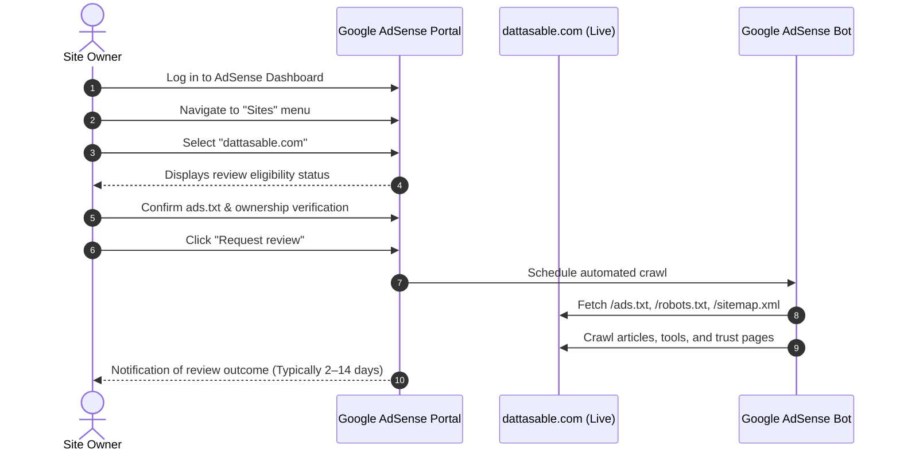

# 18 — Google AdSense Resubmission Checklist & Action Plan

**Project:** dattasable.com — Google AdSense Low-Value Content Remediation  
**Target Review Eligibility Date:** 8 November 2026  
**Publisher ID:** `ca-pub-4242010382827250`  
**Site URL:** `https://dattasable.com`  
**Auditor / Engineer:** Senior Next.js Engineer, Technical SEO Specialist & Content Quality Auditor  
**Status:** **READY FOR EXECUTION ON ELIGIBILITY DATE (8 NOVEMBER 2026)**

---

## 1. Executive Context & Timing

Following previous review attempts, the Google AdSense dashboard enforces a standard policy cooldown period. As recorded in the site audit, review eligibility for `dattasable.com` formally opens on **8 November 2026**.

> [!CAUTION]
> **MANDATORY POLICY DISCLAIMER:**
> Neither this audit, any automated tooling, nor any AI engineering team can guarantee approval from the Google AdSense Review Team. AdSense approvals are determined exclusively by Google's proprietary automated scanners and human policy reviewers evaluating site-wide value, organic traffic authenticity, commercial intent, and user experience.
> 
> However, executing this checklist ensures that all known technical, structural, architectural, and content-quality triggers for "Low-Value Content" and "Site Under Construction" rejections have been systematically identified, verified, and resolved.

---

## 2. Pre-Submission Verification Checklist (Complete by 7 November 2026)

Before submitting the review request in the AdSense portal, verify every item below on the **live production site**:

### A. Technical AdSense Plumbing
- [ ] **Publisher ID Verification:** Confirm `ca-pub-4242010382827250` matches your active Google AdSense account.
- [ ] **`ads.txt` Accessibility:**
  - Open `https://dattasable.com/ads.txt` in an incognito browser window.
  - Confirm it returns HTTP 200 with `Content-Type: text/plain`.
  - Confirm entry reads:
    ```text
    google.com, pub-4242010382827250, DIRECT, f08c47fec0942fa0
    ```
- [ ] **AdSense Header Script:**
  - Verify that the AdSense script tag is present in the `<head>` of `app/layout.tsx`:
    ```html
    <script
      async
      src="https://pagead2.googlesyndication.com/pagead/js/adsbygoogle.js?client=ca-pub-4242010382827250"
      crossorigin="anonymous"
    ></script>
    ```

### B. Content Quality & Site Experience
- [ ] **Original Content & Code:** All 126 published blog articles provide genuine technical depth (working DAX, PySpark, T-SQL, KQL examples), architectural diagrams, and official citations.
- [ ] **Zero Thin or Placeholder Content:** No "Lorem Ipsum", template placeholders, or broken layout fragments exist anywhere on public pages.
- [ ] **Trust & Policy Pages Reachability:**
  - About (`https://dattasable.com/about`)
  - Contact (`https://dattasable.com/contact`)
  - Privacy Policy (`https://dattasable.com/privacy-policy`)
  - Terms of Service (`https://dattasable.com/terms`)
  - Disclaimer (`https://dattasable.com/disclaimer`)
- [ ] **Navigation & Link Integrity:**
  - Header and footer navigation contain zero broken links.
  - All 8 intentional 404 routes remain excluded from sitemaps and unlinked in user navigation.
  - Sitemaps (`/sitemap.xml`) load quickly with zero 404 or 500 URLs.
- [ ] **Interactive Flagship Tools:**
  - Open MIS (`/tools/open-mis`) loads and renders interactive executive KPIs.
  - BI ROI Calculator (`/tools/bi-roi-calculator`) computes interactive ROI models.
  - Mermaid Forge (`/tools/mermaid-forge`) renders valid diagrams.
- [ ] **Mobile Responsiveness:**
  - Verify navigation drawer, table horizontal scrolling, and code snippet wrapping on mobile (Chrome DevTools Device Mode).

---

## 3. Step-by-Step AdSense Console Resubmission Procedure

Execute these exact steps on **8 November 2026**:



### Detailed Console Actions:
1. **Sign In:** Navigate to [Google AdSense](https://www.google.com/adsense) using the Google account associated with publisher ID `ca-pub-4242010382827250`.
2. **Access Sites List:** In the left sidebar, click on **Sites**.
3. **Select Domain:** Click on **`dattasable.com`** in the sites list.
4. **Check Verification Status:**
   - Under **ads.txt status**, verify that Google shows **"Authorized"** (green checkmark). If it shows "Not found", wait 24 hours for Google's ads.txt crawler to re-index.
5. **Acknowledge Compliance:**
   - Check the box confirming that your site complies with Google AdSense Program Policies and Webmaster Guidelines.
6. **Submit:** Click the blue **"Request review"** button.
7. **Record Submission:** Note the exact timestamp and submission ID in your administrative logs.

---

## 4. Post-Submission Monitoring Plan (Days 1 to 14)

During the AdSense review window (typically 48 hours to 14 days):

### 1. Google Search Console (GSC) Monitoring
- Check **Settings** $\to$ **Crawl stats**: Observe any surge in `Googlebot` or `Mediapartners-Google` requests.
- Check **Pages** $\to$ **Page indexing**: Ensure no new 5xx server errors or redirect errors appear.
- Monitor URL Inspection on priority remediated articles to verify Googlebot fetches fresh HTML without rendering errors.

### 2. Live Server Logs & Uptime
- Ensure Vercel deployment remains stable with 100% uptime.
- Do not run heavy database migrations or disruptive experimental deployments during the active review period.
- Ensure the autonomous AI publishing lockout remains enabled (`AI_PUBLISHING_DISABLED=true`).

### 3. Policy Center Watch
- Regularly check the **Policy center** tab in Google AdSense for any specific page-level flags or notices.

---

## 5. Review Outcome Protocols

### Scenario A: AdSense Approved ("Ready")
1. Congratulations! Your site is authorized to serve AdSense advertisements.
2. In the AdSense console, configure **Auto ads** or manual ad units.
3. Recommended ad placement strategy:
   - Keep ads off flagship interactive tools (`/tools/*`) and e-commerce checkout (`/checkout/*`) to prevent user friction.
   - Enable high-quality in-article native display units on long-form blog guides.
   - Maintain a balanced content-to-ad ratio (at least 70% content, maximum 30% ad space per viewport).

### Scenario B: Review Needs Attention / Policy Feedback
1. Do not immediately re-submit.
2. Review the specific feedback categories provided in the AdSense console (e.g., specific URLs flagged, navigation concerns, or organic search traffic thresholds).
3. Check Search Console for organic traffic trends; AdSense reviewers frequently require a sustained baseline of organic search visitors before approving new monetization accounts.
4. Address any newly surfaced policy items methodically before requesting another review.

