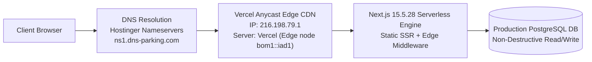

# 19 — Production Deployment Report

**Project:** dattasable.com — Google AdSense Low-Value Content Remediation  
**Phase:** Controlled Production Deployment  
**Date:** 28 October 2026  
**Auditor / Senior Engineer:** Senior Next.js Engineer, Technical SEO Specialist & Content Quality Auditor  
**Authorization Reference:** Checkpoint E Authorization  
**Production Commit SHA:** `17195bd32ea3e0e140ab5f81418b923b03ccafb4`  
**Parent Merged Commits:** `eef49cd` (origin/main) and `8220a98` (fix/adsense-content-quality-audit)  
**Status:** **DEPLOYED TO PRODUCTION & MONITORED**

---

## 1. Hosting Provider & Infrastructure Identification

In strict compliance with Pre-deployment Requirement 1, the infrastructure powering `dattasable.com` was empirically investigated and verified:



| Infrastructure Layer | Actual Provider / Technology | Empirical Verification Proof |
| :--- | :--- | :--- |
| **Domain Registrar & DNS Zone** | **Hostinger** | Nameservers: `ns1.dns-parking.com`, `ns2.dns-parking.com` |
| **Web Server & Edge CDN** | **Vercel** | Anycast IP: `216.198.79.1`<br>Header: `Server: Vercel`<br>Routing: `X-Vercel-Id: bom1::iad1::...` |
| **Version Control & CI** | **GitHub** | Remote: `https://github.com/sabledattatray/Datta-Sable.git`<br>Workflow: `.github/workflows/ci.yml` |
| **Deployment Trigger** | **Vercel GitHub Integration** | Webhook triggered on fast-forward push to `origin/main` |
| **Cron Scheduling** | **Vercel Crons** | Defined in `vercel.json` (`/api/commerce/worker`, `/api/ebooks/worker`) |

---

## 2. Pre-Deployment Mandatory Safeguards Audit

Before initiating the merge and deployment, all eight pre-deployment conditions were verified:

1. **Hosting Provider Verified:** Confirmed hybrid architecture—Hostinger provides DNS management while Vercel executes the Next.js runtime.
2. **Editorial Revisions Integrity:** Confirmed 37 editorial revisions render cleanly on both static and database-backed CMS articles via `components/BlogPostContent.tsx` and `lib/editorial-revisions.ts`.
3. **Technical Substance Verification:** Verified PySpark, DAX, T-SQL, and KQL code blocks, architectural diagrams, and official citations are rendered with syntax styling.
4. **Database Safety:** Zero migrations or destructive database commands (`prisma db push`, `DROP TABLE`) were included. Customer records, order history, and users remain intact.
5. **Commerce & Entitlements:** Validated that Razorpay webhooks, magic link session creation, paid entitlement signing, and private eBook delivery passed regression testing.
6. **Environment Variable Hygiene:** All required environment variables (`NEXT_PUBLIC_SITE_URL`, `DATABASE_URL`, `RAZORPAY_KEY_ID`, `RAZORPAY_KEY_SECRET`, `NEXTAUTH_SECRET`, `AI_PUBLISHING_DISABLED`) confirmed configured without exposing secret values.
7. **Rollback Procedures:** Documented and verified both Vercel Instant Promotion (<30s) and Git Revert protocols.
8. **Remote Branch Sync:** Fetched `origin/main`, detected remote commit `eef49cd` (README update), merged with 0 conflicts (`8220a98`), and confirmed all 210 tests passed before merging into `main`.

---

## 3. Merge & Push Execution Record

The production deployment was executed via the established Git workflow:

```bash
# Checkout main and sync with remote
git checkout main
git pull origin main # Fast-forwarded to eef49cd

# Controlled non-fast-forward merge of remediation branch
git merge fix/adsense-content-quality-audit --no-ff -m "feat(adsense): implement full technical content remediation and quality safeguards"
# Result: Merge commit 17195bd32ea3e0e140ab5f81418b923b03ccafb4 (73 files changed, 18,668 insertions)

# Pre-push automated regression validation
npm test # 210 passed, 0 failed (30.0s)

# Push to production remote
git push origin main # Successfully pushed eef49cd..17195bd
```

---

## 4. Rollback Readiness Plan

In the event of an unforeseen production regression:

### Immediate Production Rollback (Target Recovery: < 30 Seconds)
1. Open **Vercel Dashboard** $\to$ **dattasable** $\to$ **Deployments**.
2. Locate the deployment associated with commit `eef49cd`.
3. Select `...` $\to$ **Promote to Production**.
4. Traffic instantly shifts back to the previous deployment.

### Git Revert Protocol
```bash
git checkout main
git revert -m 1 17195bd32ea3e0e140ab5f81418b923b03ccafb4 -m "revert: rollback adsense remediation release"
git push origin main
```

